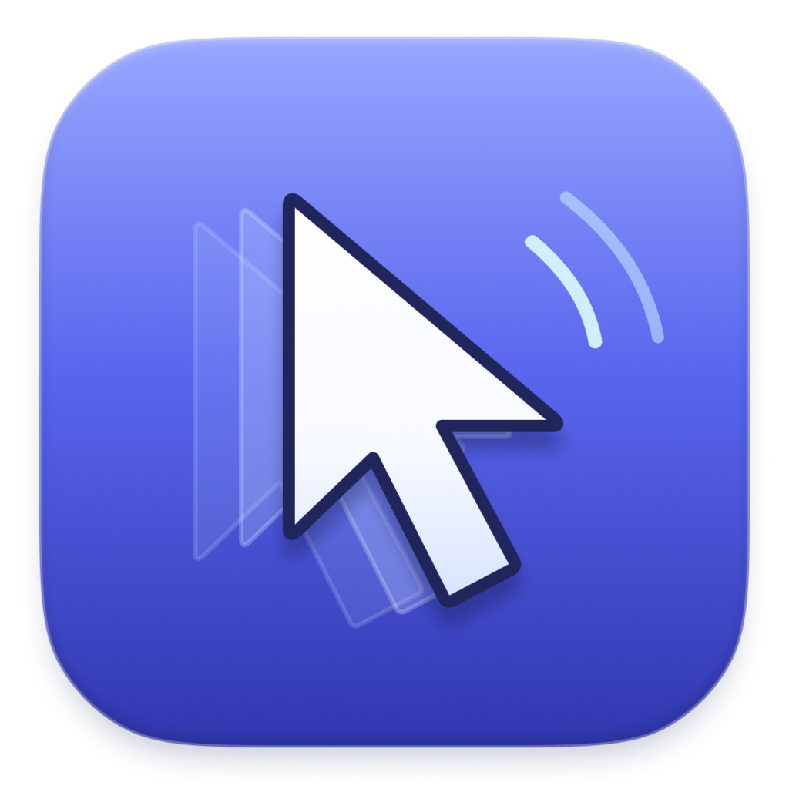

<p align="center">
  
</p>

<h1 align="center">ShakeThat</h1>

<p align="center">
  Free, open-source Dropover alternative for macOS. Shake while dragging to open a floating shelf, then drop files anywhere.
</p>

<p align="center">
  <a href="https://github.com/Ud7t/ShakeThat/releases"></a>
  <a href="LICENSE"></a>
  <a href="https://github.com/Ud7t/ShakeThat/releases"></a>
  <a href="https://github.com/Ud7t/ShakeThat/stargazers"></a>
</p>

---

## How it works

1. Start dragging one or more files (from Finder, the Desktop, Mail, anywhere).
2. Shake the cursor left and right a few times. A floating shelf appears under the cursor.
3. Let go to drop the files on the shelf. They stay there while you go find the destination.
4. Drag from the shelf to the destination folder or app. All files on the shelf go together, and the shelf closes once they've landed.

The destination decides what happens to the files, just as with a normal drag: Finder moves them within the same disk and copies them to another disk (hold Option to copy). Cancelling the drag keeps the files on the shelf.

Other bits:

- **Drop zone**: instead of shaking, drop files on the top centre of the screen (the notch on MacBooks that have one) and they go onto the shelf. It glows purple while you drag files. Shake Settings can turn it off or move it to the left or right screen edge.
- Click the menu bar icon for **Show Shelf**, **Clear Shelf**, **Shake Settings…**, and **Quit**.
- Shake Settings edits the drop zone and how hard you need to shake: the distance of each stroke, how many direction changes, the time window they must fit in, and a cooldown between shelves. Changes apply as soon as you save. The values live in `~/Library/Application Support/ShakeThat/settings.json`, which you can also edit by hand; reopen Shake Settings (or relaunch) to pick up hand edits.
- Drag the shelf by its edge to move it. Dragging the file cards drags the files out.
- The x button clears the shelf and hides it. It never deletes files; the shelf only holds references.
- Click the ... button in the shelf's corner, or right-click (or Control-click) the shelf, for one menu that acts on all of its files: **Share** (AirDrop, Mail, Messages, ...), **Copy Path**, **Reveal in Finder**, **Compress** to a zip, and **Move to Folder…**. When there are images on the shelf, **Convert** them to PNG, JPEG, HEIC or TIFF, or **Resize** them to 75%, 50% or 25%. New files are saved next to the originals and never overwrite anything. A zip or converted images take the originals' place on the shelf, and the previous shelf goes into Recent Shelves. Everything runs locally.
- **Recent Shelves** in the menu lists the last 10 shelves that were cleared (with the x, Clear Shelf, or by dragging the files out). Choosing one puts those files back on a shelf, skipping any that no longer exist. Files that were moved are found in their new place. To keep more or fewer, change `recentShelvesLimit` (1 to 100) in `settings.json`; it isn't in the Shake Settings window.
- **Pin Shelf** in the ... menu keeps a shelf around after it's cleared. Pinned shelves are listed with a pin right in the menu bar menu and at the top of Recent Shelves, and don't count toward the limit. They stay until you choose **Unpin Shelf** or their files are gone.
- Hold Option in the menu to turn a shelf's entry into **Remove “name”**, which takes it off the list.
- The **N Files** button at the bottom of the shelf opens a details panel: the total size, then each file with its name, size and a detail for its type (pixel size for images, length for videos and audio, page count for PDFs, item count for folders). Switch between a grid and a list with the toggle in its corner.

## Requirements

- macOS 13 Ventura or later
- (for building) Xcode 15+ or the Swift 5.9+ command line tools

## Download

1. Download the latest `ShakeThat-vX.Y.Z.zip` from [Releases](https://github.com/Ud7t/ShakeThat/releases).
2. Unzip it and move **ShakeThat** to your `/Applications` folder.

> **First launch:** ShakeThat is a free, open-source app, so it isn't signed with an Apple Developer ID or notarized by Apple. macOS will refuse to open it the first time with an "unidentified developer" or "can't be verified" warning. To open it anyway, right-click `ShakeThat.app` in Finder and choose **Open**, then confirm. You only need to do this once. On macOS 15 Sequoia and later, if right-click doesn't offer the option, try to open the app once, then go to **System Settings → Privacy & Security** and click **Open Anyway**.

## Build and run

```sh
git clone https://github.com/Ud7t/ShakeThat.git
cd ShakeThat
./scripts/build-app.sh
open build/ShakeThat.app
```

During development you can also run it straight from SwiftPM with `swift run`, or open `Package.swift` in Xcode.

Run the tests with `swift test`.

## Roadmap ideas

- Launch at login
- Dragging out a single file instead of the whole stack
- Multiple shelves, Quick Look, and a keyboard shortcut to open a shelf

## License

MIT, see [LICENSE](LICENSE).
